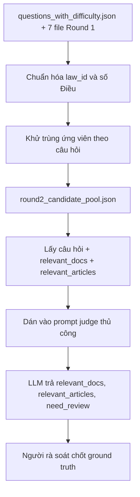

# Round 2: candidate pool cho judge thủ công

Notebook này gộp bảy file Round 1 thành danh sách ứng viên theo từng câu hỏi. Nó chỉ xử lý dữ liệu cục bộ, không gọi LLM hay API.

## Chạy notebook

Mở notebooks/round2_prepare_candidates.ipynb bằng Jupyter từ thư mục gốc project và chạy cell gộp. Notebook đọc data/test/questions_with_difficulty.json cùng đúng bảy file Round 1 trong data/results và ghi:

data/results/round2_candidate_pool.json

Mỗi hàng chứa id, question, topic, difficulty, secondary_topics, relevant_docs, relevant_articles, candidate_support và input_review_reasons. Candidate lists là phần để đưa vào judge. candidate_support chứa số phiếu và tên file model để audit; bỏ phần này khi dán vào judge để tránh tạo thiên lệch đồng thuận. Hàm show_question(id) in payload gọn; cell cuối nhận ID bạn nhập, in toàn bộ JSON và copy vào clipboard máy cục bộ (PowerShell trên Windows, Tkinter dự phòng). Nếu clipboard không khả dụng, cell báo để copy thủ công từ output.

## Cách lấy candidates từ 7 file

Notebook dùng data/test/questions_with_difficulty.json làm danh sách câu hỏi chuẩn, rồi đọc đúng các file sau trong data/results:

- vilegal_gemini-2.5-flash.json
- vilegal_gemini-3.1-flash-lite.json
- vilegal_gemini-3.5-flash-lite.json
- vilegal_gpt-5.6-luna.json
- vilegal_gpt-6-luna.json
- vilegal_gpt5-4-mini.json
- vilegal_qwen3-235b-a22b-instruct-2507.json

Mỗi file Round 1 phải là một mảng JSON có id câu hỏi duy nhất ở cấp ngoài. File không đọc được, hàng ngoài sai cấu trúc hoặc id bị lặp sẽ dừng notebook để tránh tạo candidate pool thiếu/sai. Với mỗi hàng hợp lệ, notebook lấy model_output.relevant_docs cùng model_output.relevant_articles. model_output.id phải khớp id bên ngoài; id đó phải có trong questions_with_difficulty.json. Hàng thiếu model_output, sai id hoặc thiếu hai mảng nhãn không được dùng làm candidates và được ghi lý do rà.

Việc chuẩn hóa và gộp diễn ra theo thứ tự sau:

1. Ghép kết quả vào câu hỏi bằng id; notebook không ghép theo thứ tự hàng.
2. Chuẩn hóa law_id bằng cách bỏ khoảng trắng, bỏ dấu * ở cuối và chuyển chữ thành hoa. Ví dụ các cách ghi khác nhau của cùng một số hiệu trở thành một khóa.
3. Đọc article và chỉ nhận tham chiếu parse được thành đúng một Điều. Giá trị đầu ra được chuẩn hóa về dạng Điều N; tham chiếu thiếu số Điều, có nhiều số Điều hoặc sai định dạng bị chuyển sang input_review_reasons.
4. Khử trùng relevant_articles theo khóa (id câu hỏi, law_id đã chuẩn hóa, article đã chuẩn hóa). Một file model chỉ được tính một phiếu cho một cặp dù cặp đó lặp trong file.
5. Gộp relevant_docs riêng với relevant_articles. Không tự thêm law_id vào relevant_docs chỉ vì nó có trong một article; nếu model nêu Điều nhưng quên văn bản, vẫn giữ ứng viên Điều và ghi article_law_missing_from_docs.
6. Giữ mọi ứng viên hợp lệ được ít nhất một model đề xuất. Không dùng ngưỡng đa số; votes và proposed_by chỉ để audit.

Các lỗi thường gặp được giữ ở input_review_reasons, không âm thầm sửa nhãn:

| Mã lý do | Ý nghĩa |
|---|---|
| document_only_candidate | Model nêu văn bản nhưng không nêu Điều nào của văn bản đó. Văn bản vẫn nằm trong relevant_docs. |
| article_law_missing_from_docs | Model nêu Điều nhưng không liệt kê law_id tương ứng trong relevant_docs. Cặp Điều vẫn được giữ. |
| unsupported_reference | law_id/article không chuẩn hóa được thành một cặp Điều duy nhất; ứng viên đó bị loại khỏi relevant_articles. |
| invalid_model_output_or_id, invalid_label_arrays, invalid_document_entry, invalid_article_entry | Cấu trúc hoặc kiểu dữ liệu trong output không hợp lệ; phần không hợp lệ không được gộp. |
| missing_question | File model không có hàng cho id câu hỏi đó. |
| no_candidates_from_round1 | Cả bảy file không đóng góp được văn bản hay Điều nào hợp lệ cho câu hỏi. |

File đầu ra là một object JSON có schema_version, source_files, question_count và mảng questions. Mỗi hàng trong questions có id, question, topic, difficulty, secondary_topics, relevant_docs, relevant_articles, candidate_support và input_review_reasons. candidate_support chứa votes cùng proposed_by riêng cho văn bản và Điều; để không tạo thiên lệch khi judge, chỉ dán các trường câu hỏi và hai candidate lists. Cell cuối của notebook cho phép nhập id, in toàn bộ hàng và chép hàng đó vào clipboard.

## Kết quả đã tạo

Candidate pool hiện có 2.502 câu hỏi, 42.811 cặp Điều duy nhất và 15.654 văn bản duy nhất. Có 143 câu chứa ít nhất một vấn đề đầu vào: 163 trường hợp chỉ có văn bản mà không có Điều, 65 trích dẫn không hỗ trợ chuẩn hóa và 10 Điều không có law_id tương ứng trong relevant_docs. Các con số vấn đề là số trường hợp, nên một câu có thể có nhiều hơn một.

Khi judge thủ công, mở một chat mới, dán prompt từ prompts/round2_manual_judge.md làm tin nhắn đầu tiên, rồi gửi mỗi JSON câu hỏi một lần. Judge phải chỉ chọn từ các ứng viên đầu vào, trả relevant_docs, relevant_articles và need_review; nếu không chắc hoặc ứng viên mâu thuẫn thì chuyển sang review. Output judge vẫn là nhãn tạm, cần kiểm tra trước khi thành ground truth. Prompt Round 2 được lưu tại prompts/round2_manual_judge.md; mở chat mới có Web Search, dán prompt trước rồi gửi từng JSON câu hỏi.

